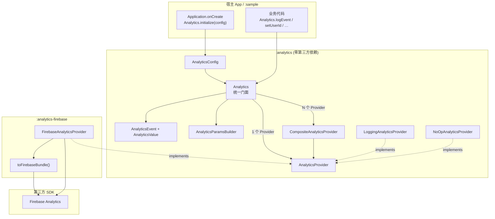
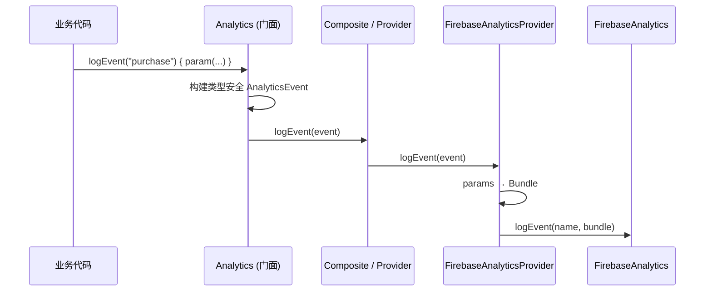

# AnalyticsKit-Android

Android 统计封装库：业务代码面向统一 API 编程，底层可插拔接入 Firebase Analytics 等 SDK。支持单个或多通道同时分发，具备强大的异常隔离与 Fail-Soft 容错能力。

---

## 特性亮点

- **统一门面 API**：业务层仅调用 `Analytics.*`，无感知底层具体第三方 SDK。
- **强类型参数体系**：通过密封类 `AnalyticsValue`（String、Long、Double、Boolean）与 Kotlin DSL，杜绝无约束的 `Map<String, Any>` 引发的厂商序列化崩溃。
- **Fail-Soft 容错分发**：多 Provider 广播分发，单个 Provider 异常被独立捕获，宿主 App 业务流程绝对不因埋点崩溃。
- **模块解耦与轻量**：核心库 `:analytics` 零第三方依赖；Firebase 适配库 `:analytics-firebase` 透出 Firebase BoM，按需接入。
- **隐私与生命周期友好**：提供全局采集总开关 `setEnabled`（合规授权即时生效）与 `reset` 登出数据清理接口。

---

## 架构



### 调用链路



---

## 产物模块

| 模块 | 说明 | 适用场景 |
| :--- | :--- | :--- |
| **[`:analytics`](analytics/)** | 核心 API、门面、契约接口、Composite / Logging / NoOp | 自建埋点服务、或自行实现私有统计 SDK 适配 |
| **[`:analytics-firebase`](analytics-firebase/)** | Firebase 适配器；依赖并透出 Firebase BOM | 需要上报到 Google Firebase Analytics |
| **[`:sample`](sample/)** | 基于 Jetpack Compose 构建的完整示例 App | 参考初始化与各类交互打点实现 |

---

## 快速接入 (JitPack)

### 1. 配置仓库源

在项目根目录的 `settings.gradle.kts` 中添加 JitPack 仓库：

```kotlin
dependencyResolutionManagement {
    repositories {
        google()
        mavenCentral()
        maven { url = uri("https://jitpack.io") }
    }
}
```

### 2. 引入依赖

在业务 App 的 `build.gradle.kts` 中添加：

```kotlin
dependencies {
    // 方案 A：含 Firebase 适配（推荐，会自动传递依赖核心 :analytics）
    implementation("com.github.e-hai.AnalyticsKit-Android:analytics-firebase:1.0.0")

    // 方案 B：仅引入核心层（不接 Firebase，纯自建或搭配其他 Provider）
    // implementation("com.github.e-hai.AnalyticsKit-Android:analytics:1.0.0")
}
```

---

## 快速开始

### 1. 在 Application 中初始化

```kotlin
class App : Application() {
    override fun onCreate() {
        super.onCreate()
        
        Analytics.initialize(
            context = this,
            config = AnalyticsConfig(
                providers = listOf(
                    LoggingAnalyticsProvider(),   // Logcat 本地控制台调试日志
                    FirebaseAnalyticsProvider(),  // 生产环境 Firebase 统计
                ),
                enabled = true,
                debug = BuildConfig.DEBUG,        // Debug 模式下输出警告与失败诊断
            ),
        )
    }
}
```

### 2. 业务打点与事件追踪

```kotlin
// 1. Kotlin DSL 链式事件打点（强类型安全）
Analytics.logEvent("purchase") {
    param("item_id", "sku_1001")
    param("price", 99.9)
    param("quantity", 1)
    param("is_vip", true)
}

// 2. 页面访问追踪
Analytics.logScreenView(screenName = "HomeActivity", screenClass = "HomeActivity")

// 3. 用户标识与自定义属性
Analytics.setUserId("user_1024")
Analytics.setUserProperty("cohort", "beta_user")

// 4. 动态采集开关（例如合规授权）
Analytics.setEnabled(false)

// 5. 用户登出时数据清理
Analytics.reset()
```

---

## Firebase 接入详细配置

若接入 `:analytics-firebase`，请确保以下配置就绪：

1. 打开 [Firebase Console](https://console.firebase.google.com/) 添加 Android 应用；
2. 应用包名必须与 App 的 `applicationId` 严格保持一致；
3. 下载 `google-services.json` 放置在 App 模块根目录下；
4. 在 App 模块的 `build.gradle.kts` 中应用 Google Services 插件：

```kotlin
plugins {
    alias(libs.plugins.google.services) // 或 id("com.google.gms.google-services")
}
```

### 常见排错：
- **`Missing google_app_id`**：未应用 Google Services 插件，或 `google-services.json` 中的 `package_name` 与当前构建变体的 `applicationId` 不匹配。
- **`API_KEY_INVALID`**：使用了非本工程的 Mock 配置，需在 Firebase 控制台下载对应真实凭证。

---

## 扩展自定义 Provider

接入自建数据平台或其他第三方 SDK（如 AppsFlyer），只需实现 `AnalyticsProvider` 接口：

```kotlin
import com.kit.analytics.AnalyticsEvent
import com.kit.analytics.provider.AnalyticsProvider

class CustomAnalyticsProvider : AnalyticsProvider {
    override val name: String = "custom_vendor"

    override fun initialize(context: Context) {
        // 初始化三方 SDK
    }

    override fun logEvent(event: AnalyticsEvent) {
        // 将 event.params (AnalyticsValue) 转换为目标厂商数据格式并上报
    }

    override fun setUserId(userId: String?) { ... }
    override fun setUserProperty(name: String, value: String?) { ... }
    override fun setAnalyticsCollectionEnabled(enabled: Boolean) { ... }
    override fun resetAnalyticsData() { ... }
}
```

并在 `AnalyticsConfig.providers` 列表中注册，门面会自动统一调度分发。

---

## 代码混淆 (ProGuard / R8)

核心库与适配器库已内置消费者混淆规则（`consumer-rules`），宿主 App 接入时**无需额外配置 ProGuard 规则**。

---

## 目录结构

```
AnalyticsKit-Android/
├── analytics/                 # 核心模块（门面、契约、DSL、Composite 分发）
├── analytics-firebase/        # Firebase 适配器模块
├── sample/                    # Jetpack Compose 演示应用
├── gradle/                    # 依赖版本管理与发布脚本
├── AGENTS.md                  # 开发与维护规则
└── README.md
```

## 许可证

本项目基于 [Apache License 2.0](http://www.apache.org/licenses/LICENSE-2.0.txt) 协议开源。
